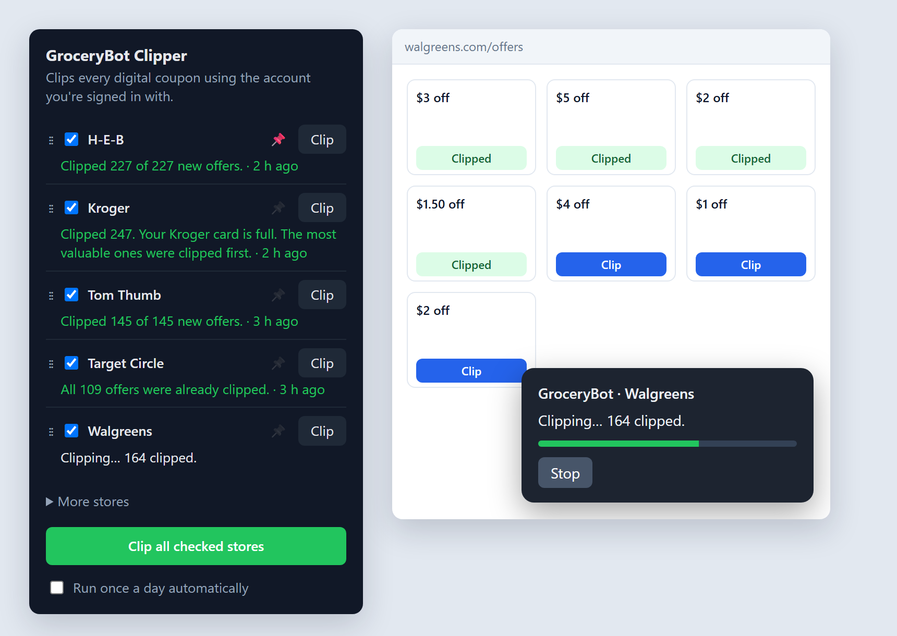

#  CouponSweep: Auto Coupon Clipper

**Automatically clip every digital coupon in one click.** CouponSweep is a free,
open-source Chrome extension that loads all of your store's digital coupons to
your card: Kroger, H-E-B, Target Circle, Walmart Cash, CVS ExtraCare,
Walgreens, BJ's, Safeway, Albertsons, Tom Thumb and about 30 more grocery and
pharmacy chains. No more clicking "Clip" hundreds of times.

It runs in the browser you're already signed in with, never sees your password,
and sends nothing anywhere except to the store itself.

> **Unofficial tool, use at your own risk.** CouponSweep isn't affiliated with
> or endorsed by any store. Automatically clipping coupons may go against a
> store's terms of use, and a store could limit or close an account it thinks
> is automated. Use it only on your own account. See the [Disclaimer](#disclaimer).



**Why people use it**

- **Clip all coupons at once.** One run clips every available coupon, often hundreds per store, while you do something else.
- **One button for every store.** Check the stores you shop at and click *Clip all checked stores*, or let it run once a day.
- **Smart about limits.** Where a store caps how many coupons a card can hold (Kroger, Walgreens), the biggest savings get clipped first.
- **Private.** No account, no servers, no tracking. See the [privacy policy](PRIVACY.md).
- **Works in Chrome, Edge and Brave.**

## Supported stores

| Store | Status | How it clips |
|---|---|---|
| **H-E-B** digital coupons | ✅ Working | H-E-B's own coupon list and clip request |
| **Target Circle** offers | ✅ Working | Target's offer list and its "save offer" request (only *Coupons to apply* need saving; other Circle deals apply automatically) |
| **Kroger** family digital coupons: Kroger, Ralphs, Fry's, King Soopers, Fred Meyer, Smith's, QFC, Dillons, City Market, Baker's, Gerbes, Jay C, Pay Less, Mariano's, Pick 'n Save, Metro Market, Foods Co, Food 4 Less | ✅ Working (tested on Kroger) | Kroger's coupon list and clip requests. Kroger limits how many coupons a card holds, so the most valuable coupons are clipped first. |
| **Albertsons** family "for U" / Just for U coupons: Albertsons, Tom Thumb, Safeway, Vons, Randalls, Jewel-Osco, Acme, Shaw's, Star Market, Pavilions, Andronico's, Carrs, Haggen, Kings, Balducci's | ✅ Working (tested on Tom Thumb) | The "for U" coupon gallery and clip requests. Never touches points-redemption rewards. |
| **Walmart Cash** offers | ✅ Working | Presses the page's own "Get this offer" and "Next page" buttons, so Walmart's code sends every request. Slower than the others and more likely to break when Walmart redesigns the page. |
| **CVS ExtraCare** coupons (Send to card) | ✅ Working | Presses the page's own "Send to card" buttons (CVS only accepts its own page's requests). Sends ExtraBucks rewards to your card too, which spends nothing. |
| **Walgreens** digital coupons | ✅ Working | Presses the page's own "Clip" buttons. Accounts hold up to 200 clipped coupons, so the biggest dollar amounts go first. |
| **BJ's Wholesale Club** coupons | ✅ Working | Presses the page's own "CLIP" buttons on My Coupons, biggest dollar amounts first. |

Want another store? [Request it](https://github.com/MrClumzy88/couponsweep/issues/new?template=store_request.yml).
Costco, Sam's Club, Trader Joe's and Aldi don't have clippable digital coupons, so there's nothing to automate there.

## Install

1. Download the ZIP from the [latest release](https://github.com/MrClumzy88/couponsweep/releases/latest)
   and unzip it somewhere you'll keep it (for example `Documents\couponsweep`).
2. Open `chrome://extensions` in Chrome (or Edge or Brave).
3. Turn on **Developer mode** (top right).
4. Click **Load unpacked** and choose the unzipped folder (the one with `manifest.json`).
5. Pin the extension from the puzzle-piece menu so the button is easy to find.

## Updating

Extensions installed this way don't update themselves. When a new version is
out, the popup shows **Update available** with a link. To be emailed instead,
click **Watch → Custom → Releases** at the top of this page.

To update without losing your store choices and history:

1. Download the new release ZIP.
2. Unzip it **over your existing folder**, replacing the old files. (A new
   folder counts as a different extension to Chrome and starts from scratch.)
3. In `chrome://extensions`, click the ↻ reload arrow on CouponSweep.

## Use

1. Sign in to the store's website normally, in this browser.
2. Open the extension's popup and check the stores you shop at (under **More stores**).
3. Either:
   - click the extension's button and choose **Clip** (or **Clip all checked stores**), or
   - open the store's coupons page and click the green **✂ Clip all coupons** button in the corner.
4. A small panel shows progress. Leave the tab open until it says it's done.

Optional: check **Run once a day automatically** in the popup. Chrome has to be
open at the time; tabs it opens close themselves when a run finishes cleanly.

The popup remembers each store's last result, for example
*"Clipped 212 of 214 new offers (2 failed) · 3 h ago"*.

## FAQ

**How do I clip all Kroger digital coupons at once?**
Install CouponSweep, sign in at kroger.com, open the extension and click **Clip**
next to Kroger. It clips everything it can until your card is full, highest
savings first. The same works for Ralphs, Fry's, King Soopers, Fred Meyer and
the other Kroger stores.

**Can it automatically clip Safeway, Albertsons or Tom Thumb "for U" coupons?**
Yes. All Albertsons Companies stores share one coupon system, and CouponSweep
clips every "for U" (Just for U) coupon on them.

**Does it work for H-E-B, Target Circle and Walmart Cash?**
Yes: H-E-B digital coupons, Target Circle "Coupons to apply", and Walmart Cash
offers are all supported.

**Does it load CVS ExtraCare coupons and Walgreens coupons to my card?**
Yes. On CVS it presses every "Send to card"; on Walgreens it clips up to the
200-coupon account limit, biggest savings first.

**Is it safe? Does it need my password?**
No password, ever. You sign in to each store yourself; CouponSweep runs inside
that page and only talks to that store. It's open source, so anyone can read
exactly what it does. See [How it works](#how-it-works) and the [privacy policy](PRIVACY.md).

**Can it clip coupons automatically every day?**
Yes: turn on **Run once a day automatically** in the popup. Chrome needs to be
open at the time, and you need to stay signed in to the stores.

**Does it work in Edge, Brave or Firefox?**
Edge and Brave, yes (they run Chrome extensions). Firefox isn't supported yet.

**Will clipping coupons cost me anything or spend my rewards?**
No. Clipping only makes a coupon available at checkout. CouponSweep never
redeems points or spends rewards.

## How it works

The extension doesn't log in for you and never sees your password. It runs
inside the store's own page, in the session you already have, and makes the
same requests the store's **Clip** button makes. (Walmart, CVS, Walgreens and
BJ's only accept requests from their own site code, so there it presses the
store's own buttons instead.)

1. Fetch the full list of offers with their clipped/unclipped status.
2. Send one clip request per unclipped offer, with a short random pause between
   them so it isn't a burst of traffic.
3. Stop right away, with a plain message, if the site says you're signed out,
   asks for a human check (CAPTCHA), or starts refusing requests. It never
   tries to get around those; complete the check yourself and run it again.

Nothing leaves your browser except those requests to the store itself, plus a
check with GitHub (at most every six hours) for a newer version. There are no
servers, no analytics and no tracking. Results are kept in the extension's
local storage only. See the [privacy policy](PRIVACY.md).

**Why it asks for access to so many sites:** Chrome needs permission for each
store's website before the extension can run on its coupon page. It only acts
on those stores' pages, and only when you start a run (or turn on the daily run).

## Project layout

```
manifest.json        Chrome extension manifest (MV3)
background.js        Opens store tabs, runs stores one at a time, saves results
stores.js            The list of supported stores
popup.html/.js/.css  The toolbar popup
icons/              Extension icons (icon.svg is the source)
scripts/check.mjs    Checks run on every pull request
docs/               README screenshot and its source page
content/bridge.js    Relays messages between the page and the extension
content/runner.js    Shared progress panel, pacing and result counting
content/<store>.js   One adapter per store
```

### Adding a store

1. Add an entry to `stores.js`.
2. Write `content/<id>.js`, which calls `window.__gbc.register({ id, name, isCouponPage, run })`.
   In `run(ctx)`, list the offers, call `ctx.found(total, alreadyClipped)`, then
   call `ctx.clip(async () => …returns true on success…)` once per offer.
   Throw `ctx.fail("login" | "blocked" | "error", "message for the user")` to stop.
3. Add the site to `host_permissions` and `content_scripts` in `manifest.json`.

`content/heb.js` is the simplest example to copy. Stores that share a backend
share an adapter (all Albertsons-family banners use `content/albertsons.js`,
all Kroger-family banners use `content/kroger.js`).

## Credits

The Albertsons-family endpoints follow
[nathanrcast/clip-all-coupons](https://github.com/nathanrcast/clip-all-coupons) (MIT).

## When something breaks

Stores change their websites. If a store stops working:

- Reload the store's page and try again (H-E-B in particular changes its site version often).
- Open DevTools (F12) → Console on the store's tab and look for lines starting with `[CouponSweep]`.
- Open an issue with the store name and that console output.

## Contributing

Ideas go in [Discussions](https://github.com/MrClumzy88/couponsweep/discussions),
problems and store requests in [Issues](https://github.com/MrClumzy88/couponsweep/issues).
See [CONTRIBUTING.md](CONTRIBUTING.md) for how to add a store.

## Disclaimer

This is an unofficial personal tool. It isn't affiliated with or endorsed by
H-E-B, Target, Walmart or any other retailer, and store names are used only to
say which sites it works with. Automating coupon clipping may be against a
store's terms of use, and a store could limit, suspend or close an account it
believes is automated. It's meant for personal, low-volume use on your own
account: it clips one coupon at a time with pauses, and stops when a store
pushes back. Use it at your own risk, and double-check your coupons before you
shop. The software is provided as is, without warranty (see the [license](LICENSE)).

The extension shows this notice the first time you open it, and won't clip
anything until you accept it.

## License

[MIT](LICENSE)
